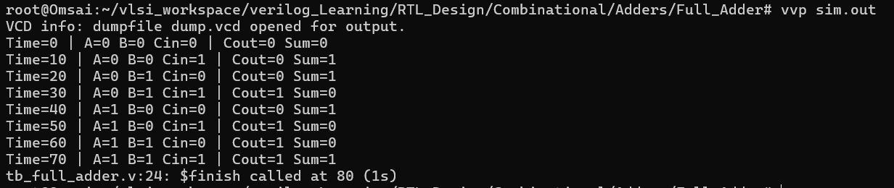
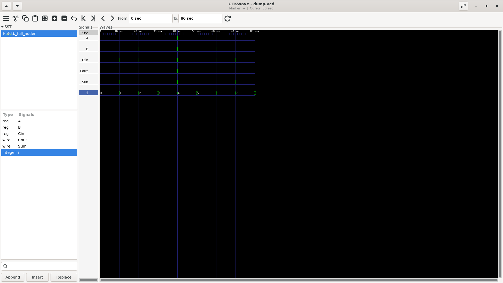

# Full Adder

A 1-bit Full Adder is a combinational circuit that adds three 1-bit inputs — **A**, **B**, and **Cin** — and produces two outputs: **Sum** and **Cout**.

## Simulation Output

The testbench applies all 8 possible input combinations and displays the corresponding outputs. The terminal output shows the Full Adder's expected truth-table behaviour.

## GTKWave Waveform

The waveform shows how the inputs **A**, **B**, and **Cin** change across the eight test cases, and how **Sum** and **Cout** respond to each combination.

## Logic

- **Sum** = A XOR B XOR Cin
- **Cout** = (A AND B) OR (A AND Cin) OR (B AND Cin)

The simulation verifies the circuit for every possible 3-bit input combination.
