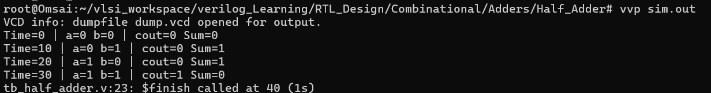
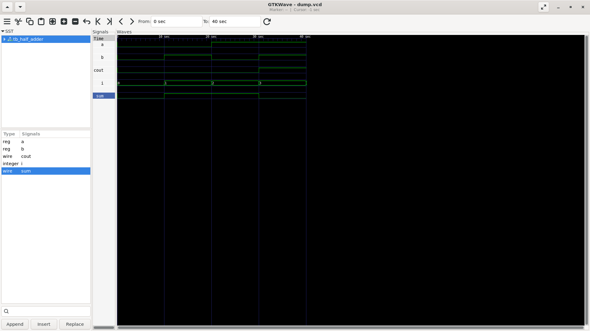

# Half Adder

A 1-bit combinational circuit that adds two inputs (**A** and **B**) and produces **Sum** and **Carry**.

## Simulation Output

The testbench checks all four input combinations.

## GTKWave Waveform

