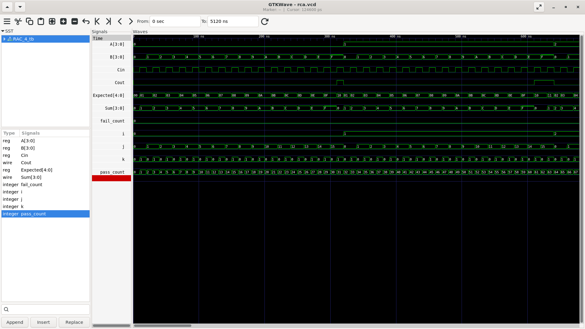

# 4-bit Ripple Carry Adder (RCA)

A hierarchical 4-bit Ripple Carry Adder designed in Verilog using four 1-bit Full Adder modules.

## Project Overview

A Ripple Carry Adder performs binary addition by connecting Full Adders in series. Each stage passes its carry output to the carry input of the next stage.

- **Inputs:** A[3:0], B[3:0], Cin
- **Outputs:** Sum[3:0], Cout
- **Architecture:** Four cascaded Full Adders
- **RTL style:** Gate-level Full Adder with hierarchical module instantiation
- **Verification:** Self-checking testbench with exhaustive input testing

## Project Files

| File | Description |
|---|---|
| [full_adder.v](./full_adder.v) | 1-bit Full Adder implemented using XOR, AND and OR primitives |
| [RAC_4.v](./RAC_4.v) | Top-level 4-bit Ripple Carry Adder using four Full Adder instances |
| [RAC_4_tb.v](./RAC_4_tb.v) | Self-checking testbench for all input combinations |

## Architecture

The carry propagates from the least significant bit (bit 0) to the most significant bit (bit 3).

```text
       A[0] B[0]       A[1] B[1]       A[2] B[2]       A[3] B[3]
          |                |                |                |
Cin ----> FA0 -- c1 ----> FA1 -- c2 ----> FA2 -- c3 ----> FA3 ----> Cout
          |                |                |                |
        Sum[0]           Sum[1]           Sum[2]           Sum[3]
```

Each Full Adder calculates one sum bit and generates the carry for the next stage.

## Full Adder Logic

For each stage:

- Sum is generated using two XOR operations.
- Carry is generated using three AND terms combined by an OR gate.

## Timing Characteristics

The carry must propagate through successive Full Adder stages before the most-significant result is fully determined. As the adder width increases, this serial carry path becomes longer. This makes the Ripple Carry Adder structurally simple and easy to build hierarchically, but generally slower than faster carry architectures such as carry-lookahead adders for wider operands. This is a qualitative architecture comparison, not a measured timing result for this implementation.

## Verification

The testbench checks every possible combination of the two 4-bit operands and the carry input:

```text
16 possible A values × 16 possible B values × 2 Cin values
= 512 test cases
```

For each test, the testbench computes an expected 5-bit result and compares it with the DUT output `{Cout, Sum}`. A mismatch is reported as FAIL; matching results increment the pass counter.

## Run Simulation

Run these commands from this project directory:

```bash
iverilog -g2012 -Wall -o sim.out full_adder.v RAC_4.v RAC_4_tb.v
vvp sim.out
gtkwave rca.vcd
```

The testbench writes the waveform to `rca.vcd`.

## Simulation Waveform

The GTKWave screenshot below shows the exhaustive testbench activity, including operand inputs, carry input, expected result, sum, carry output, and test counters.



## Learning Outcomes

- Hierarchical RTL design through module instantiation.
- Gate-level modeling with Verilog primitives.
- Carry propagation through cascaded Full Adders.
- Self-checking testbench development.
- Exhaustive functional verification and waveform inspection.

---

**Design focus:** Understand how a 1-bit Full Adder becomes a wider arithmetic block through hierarchy and carry chaining.
