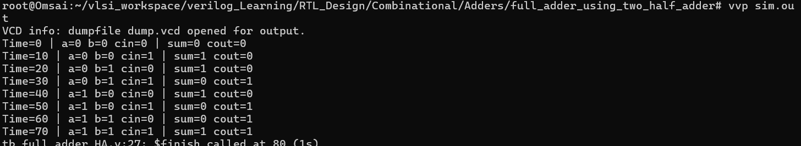
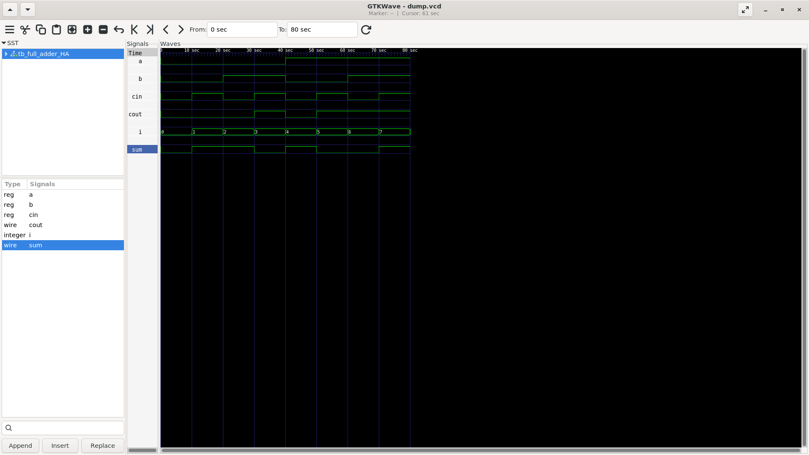

# Full Adder Using Two Half Adders

A 1-bit Full Adder implemented hierarchically using two Half Adder modules and an OR gate.

## Architecture

1. The first Half Adder adds **A** and **B**, producing an intermediate sum (**S1**) and carry (**C1**).
2. The second Half Adder adds **S1** and **Cin**, producing the final **Sum** and carry (**C2**).
3. An OR gate combines the two carry outputs to produce **Cout**.

## Boolean Relationships

- **S1** = A XOR B
- **C1** = A AND B
- **Sum** = S1 XOR Cin
- **C2** = S1 AND Cin
- **Cout** = C1 OR C2

This hierarchy demonstrates module reuse: the Full Adder is assembled from two instances of the previously designed Half Adder.

## Simulation Output

The testbench checks all eight input combinations.

## GTKWave Waveform

